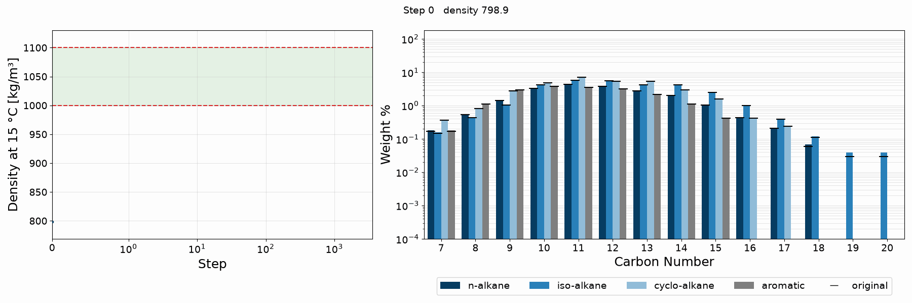

Inverse
=======

**Inverse** designs fuel blends from property targets. Starting from the
detailed composition of a base fuel, it finds an addition of compounds, and the
fraction of the blend that addition makes up, such that the blended fuel meets
a set of property limits (density, viscosity, heat of combustion, flash point,
freezing point, and aromatics content). Among the blends that satisfy those
limits, it prefers ones that avoid small, impractical additions of many
different compounds.

Every mixture property is computed with differentiable mixing rules (see
:doc:`mix`), so the whole problem can be solved with gradient-based
optimization. The constraints are enforced with an augmented Lagrangian (see
:doc:`problem` and :doc:`optimize`), and all settings are collected in a single
validated configuration (see :doc:`models`).

Example
-------

The example in ``examples/density.py`` raises the density at 15 °C of the
FuelLib fuel ``posf10325`` into the range 1000-1100 kg/m\ :sup:`3`:

.. code-block:: python

   from fuellib import Fuel
   from inverse import Config, Problem, solve

   fuel = Fuel("posf10325")
   config = Config(
       density_weight=1000.0,
       density_min=1000.0,
       density_max=1100.0,
   )
   problem = Problem(fuel, config)
   result = solve(problem)

The animation shows the optimization history. The left panel tracks the blend
density against its limits (dashed lines, with the feasible range shaded), and
the right panel shows the blend composition by hydrocarbon family and carbon
number, with the base fuel composition marked by black ticks.

Dependencies
------------

Inverse builds on the following packages:

* `github.com/NatLabRockies/FuelLib <https://github.com/NatLabRockies/FuelLib>`_\
  :footcite:p:`fuellib_2025`, the primary dependency. FuelLib provides the
  base fuel compositions from gas chromatography data and the group
  contribution estimates of the component properties.
* `JAX <https://github.com/jax-ml/jax>`_\ :footcite:p:`jax2018github`
  provides the array operations, automatic differentiation (including the
  implicit differentiation of the flash and freezing points), and just-in-time
  compilation.
* `Optax <https://github.com/google-deepmind/optax>`_\ :footcite:p:`deepmind2020jax`
  provides the Adam optimizer and the simplex projection used to
  parameterize the addition.

.. toctree::
   :maxdepth: 2
   :caption: Contents

   mix
   problem
   optimize
   models
   api

.. toctree::
   :maxdepth: 2
   :caption: Development

   contributing

.. footbibliography::
